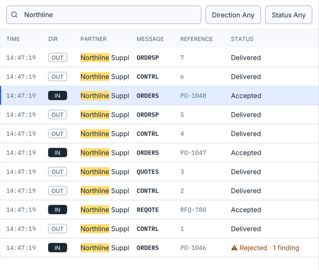
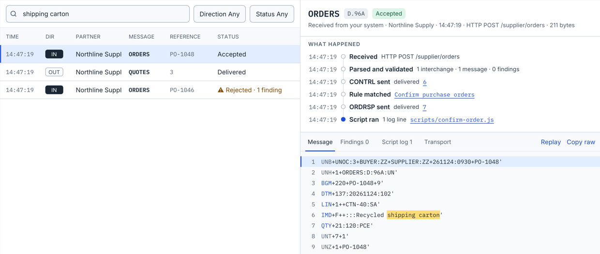
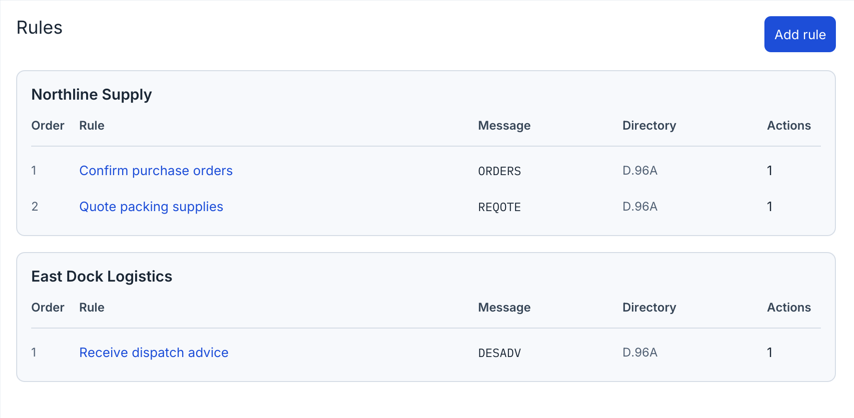

# Find traffic and inspect its rules

For the complete walkthrough with full-resolution screenshots, open the [workspace handbook](index.html).

## Search the traffic table

Open **All traffic** and type in **Search traffic and message text**. A transfer appears when any table field or its message body contains the search text. Search ignores case and treats punctuation literally, so you can search for EDIFACT fragments such as `BGM+220`.

| To find | Try |
| --- | --- |
| A time | The local time shown in the table, or a fragment such as `14:47` |
| A direction | `IN` or `OUT`. For an exact direction, use the **Direction** filter. |
| A partner | `Northline` |
| A message type or interchange reference | `ORDERS` or `PO-1048` |
| A status | `Delivered`, `Accepted`, or `finding` |
| Text inside an interchange | `shipping carton` |

In the starter workspace, searching for `Northline` highlights the matching part of each partner name. Search works within the current partner, attention view, direction and status filters. Delete the search text to keep the other filters.

## Find a match inside a message

Search for `shipping carton`, select a result, and open **Message**. The inspector scrolls to the first matching text and highlights occurrences in the raw segments. In purchase order PO-1048 the phrase appears in the IMD item description. At compact window sizes, select the transfer to open its inspector and use **Back to traffic** to return.

## Read rule order

Open **Rules** to see each partner’s processing order. Read across a row to see its message type, EDIFACT directory and number of actions. Vendredi runs the first matching rule for that partner. Select a rule name to edit its match, actions or position, or follow **Rule matched** in a transfer’s timeline to open the rule that ran.

